# Propositions de design — à valider ensemble

Branche `design/direction-v3`. **Aucun fichier de code n'est modifié.** Ce dossier contient :

| Fichier | Rôle |
|---|---|
| [`../../DESIGN.md`](../../DESIGN.md) | le système cible : 5 tailles de police, 1 rayon, 4 durées, la doctrine du chrome |
| [`../audit-ui.md`](../audit-ui.md) | l'audit mesuré du chrome + la liste des 11 éléments à supprimer, avec `fichier:ligne` |
| [`../audit-3d.md`](../audit-3d.md) | l'audit du rendu 3D + le plan AO / bloom / TAA / grain |
| `*.html` | les maquettes, fidèles au pixel, chargées avec les vraies polices et les vrais tableaux |
| `shots/` | les captures de ces maquettes (1440×900 et 390×844) |
| `3d/` | les variantes de rendu 3D |
| `refs/` | les plaques 3D nettoyées (HUD masqué) utilisées comme fond des maquettes |

Les maquettes sont posées sur une **capture réelle de la scène 3D avec le HUD masqué** : ce que tu
vois est donc bien l'écran final, à l'exception des améliorations de rendu 3D (traitées au point 3).

---

## 0. Avant / après, en une image

[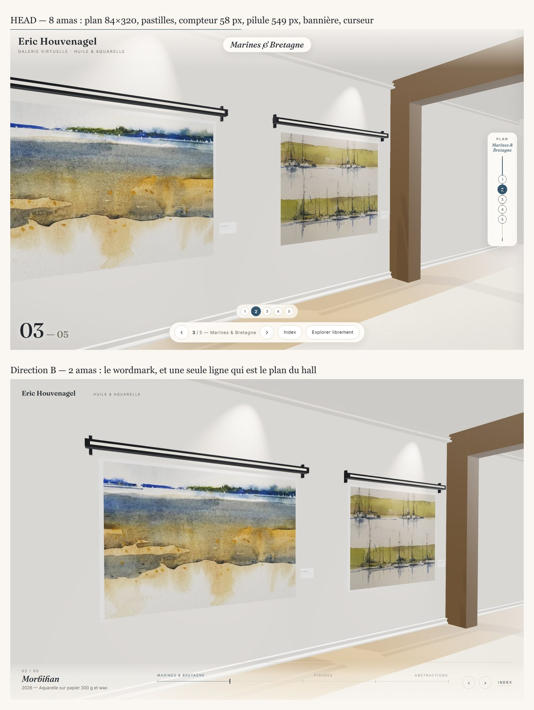](avant-apres-desktop.jpg)

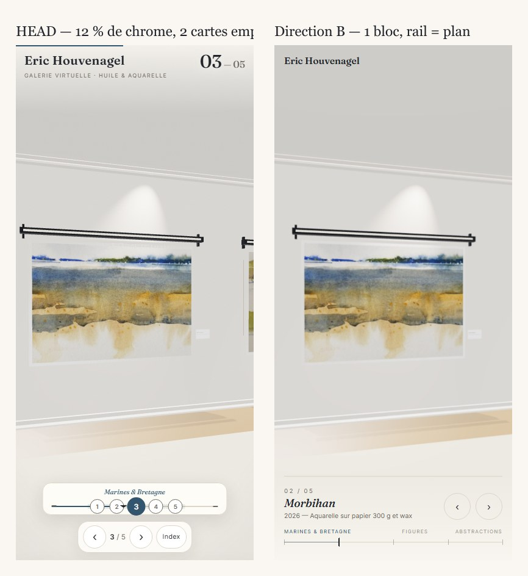

À gauche/au-dessus : `HEAD`. À droite/en dessous : la direction B. La scène 3D est identique dans
les deux captures — **tout le gain visible ici est du chrome en moins**, pas du rendu.

---

## 1. Le chrome : trois directions

### A — « Salle blanche » · trois amas, rien d'autre

[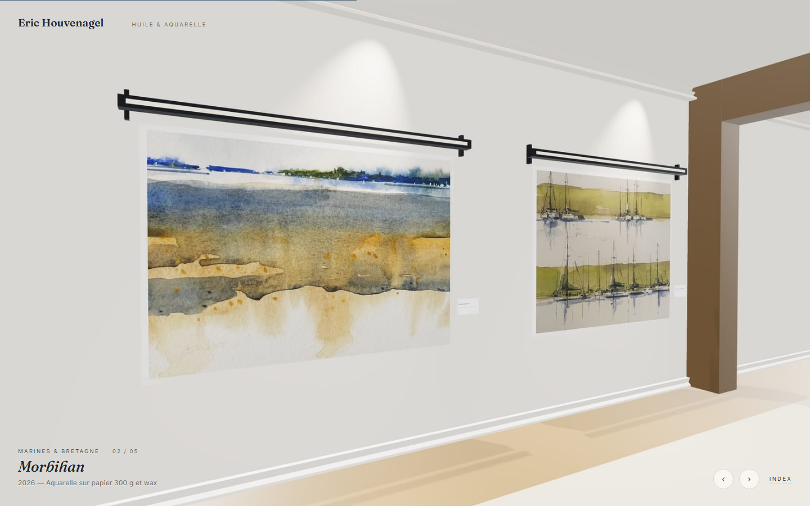](shots/A-desk-view.png)

> Identité en haut à gauche, légende en bas à gauche, deux flèches + « Index » en bas à droite.
> **Supprimés** : le plan flottant, les 5 pastilles, le compteur géant, la bannière de salle, le
> curseur « Voir », les deux hints. Un filet de 1 px en haut dit où l'on en est.

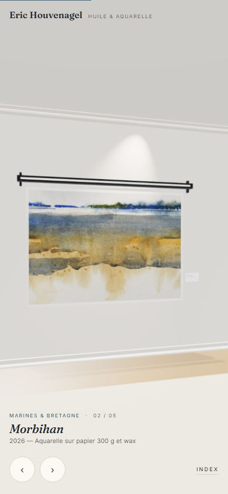

| | |
|---|---|
| Amas | **3** (contre 8) |
| Surface de chrome | ≈ 3 % de l'écran (contre 8 %) |
| Ce qu'on perd | l'accès direct à une œuvre depuis le plan (il reste l'index, 1 clic) |
| Coût | le plus faible des trois : on supprime, on ne recompose presque rien |
| Risque | au-delà de ~10 œuvres, la navigation directe manque |

---

### B — « Cartel » · une seule ligne qui EST le plan

[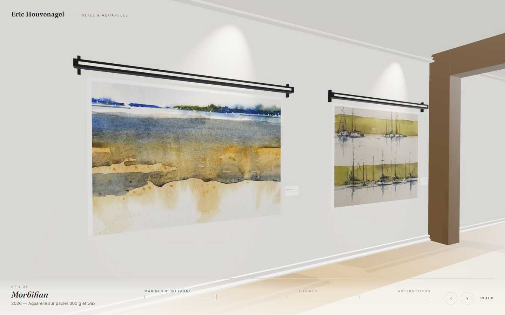](shots/B-desk-view.png)

> Deux amas. En bas, un filet pleine largeur qui porte tout : les trois salles, les cinq œuvres en
> graduations de 1 px, la caméra, la légende, et les commandes. Le plan flottant disparaît — le
> rail *est* le plan. La trajectoire est cliquable.

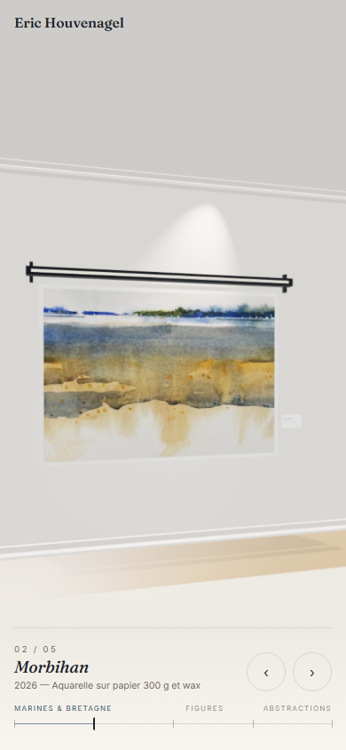

| | |
|---|---|
| Amas | **2** (contre 8) |
| Surface de chrome | ≈ 5 % de l'écran, mais **zéro carte flottante** |
| Ce qu'on gagne | on garde la navigation directe, et on supprime quand même 6 amas sur 8 |
| Coût | moyen : `src/gallery/minimap.ts` passe de 159 à ~50 lignes (rail au lieu de carte) |
| Risque | sur 390 px, 5 cibles sur 358 px de rail = 71 px d'écart, suffisant ; au-delà de 12 œuvres il faudra regrouper par salle |

C'est la direction qui **supprime le plus en gardant le plus de fonction**. C'est ma recommandation
pour le desktop, avec A pour le mobile.

---

### C — « Plein cadre » · la scène d'abord, tout le reste à la demande

> Au repos : un wordmark de 12,5 px capitales et un filet. Littéralement rien d'autre.

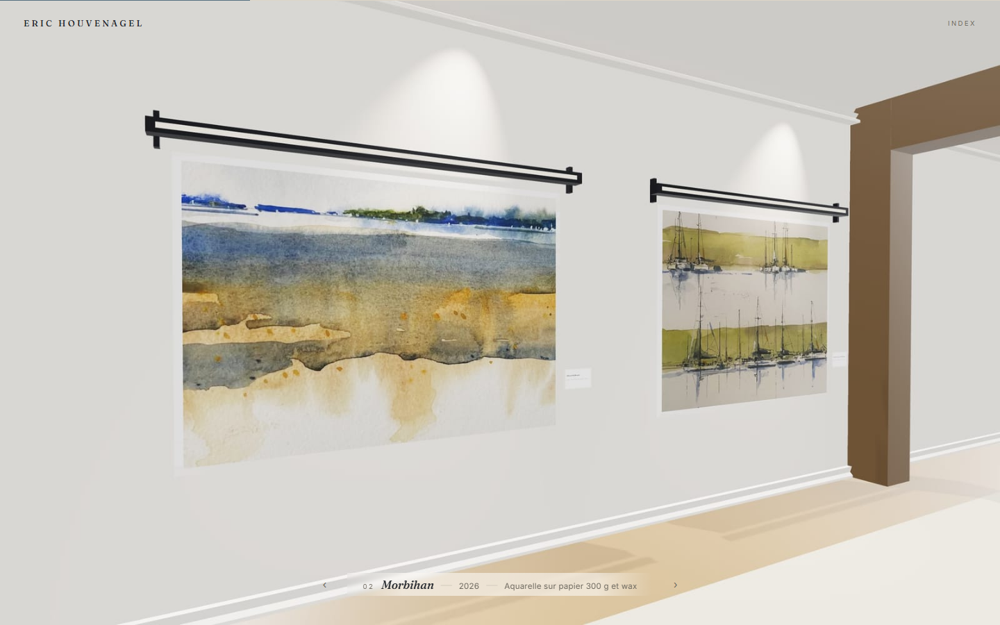

> Au premier mouvement : une seule ligne de légende au centre bas — « 02 · Morbihan — 2026 —
> Aquarelle sur papier 300 g et wax » — deux flèches nues, et « Index » en haut à droite.

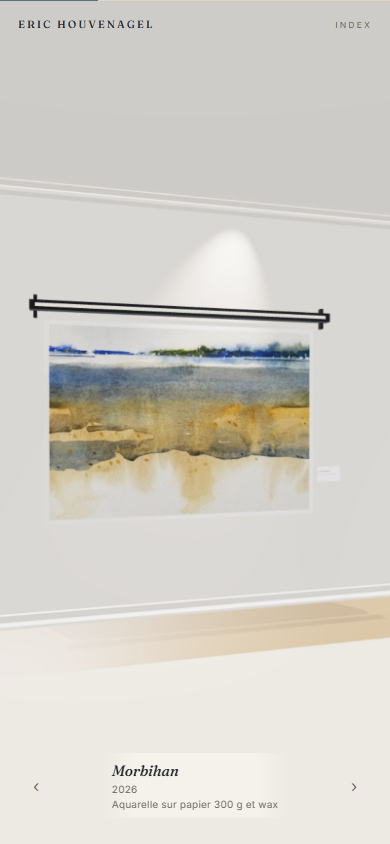

| | |
|---|---|
| Amas | **1 au repos**, 3 à la demande |
| Surface de chrome au repos | < 1 % |
| Ce qu'on gagne | l'expérience la plus proche d'une salle réelle ; c'est la plus ambitieuse |
| Ce qu'on perd | la découverte : un visiteur qui ne bouge pas la souris ne voit aucune commande |
| Coût | moyen (il faut gérer révélation au clavier, au scroll et au survol) |
| Risque | accessibilité : `Tab` doit révéler la légende. À traiter dans l'implémentation |

---

## 2. La fiche d'œuvre — spec commune

[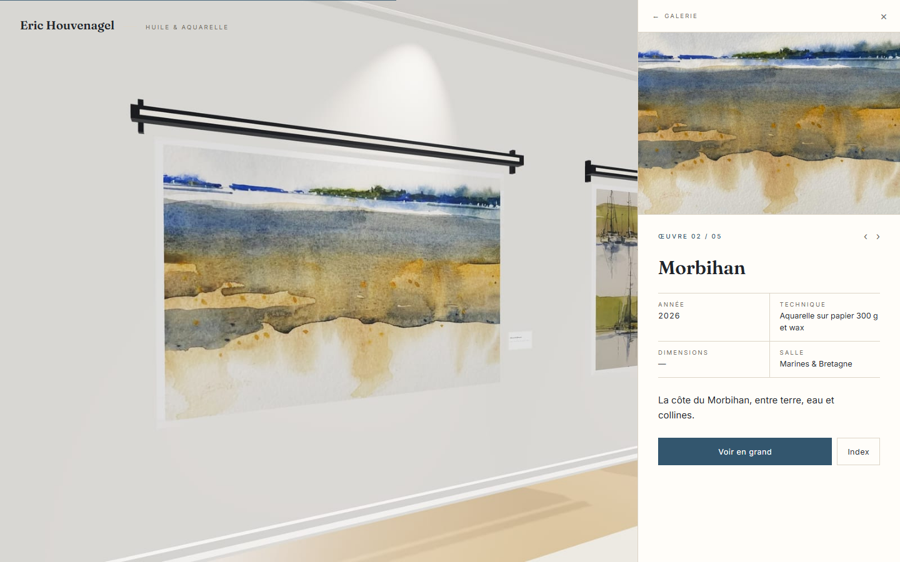](shots/A-desk-panel.png)

Ce qui change par rapport à `HEAD` :

| Avant | Après |
|---|---|
| Image arrondie 8 px, bordée 1 px, ombrée, sur fond blanc | **bord à bord, rayon 0, sans bordure ni ombre** |
| Méta en une ligne « 2026 — Aquarelle sur papier 300 g et wax — — » | **grille 2 × 2** : Année / Technique / Dimensions / Salle, filets 1 px |
| « Précédente · Voir en grand · Suivante » en 3 boutons pleine largeur (148 px) | **une rangée** : 1 action pleine + 1 filet ; précédent/suivant remontés dans le kicker |
| Titre 33 px (n'existe nulle part ailleurs) | **28 px**, la marche `--t4` |
| Croix dans un cercle flottant | barre de titre de 52 px : `← Galerie` … `×` |

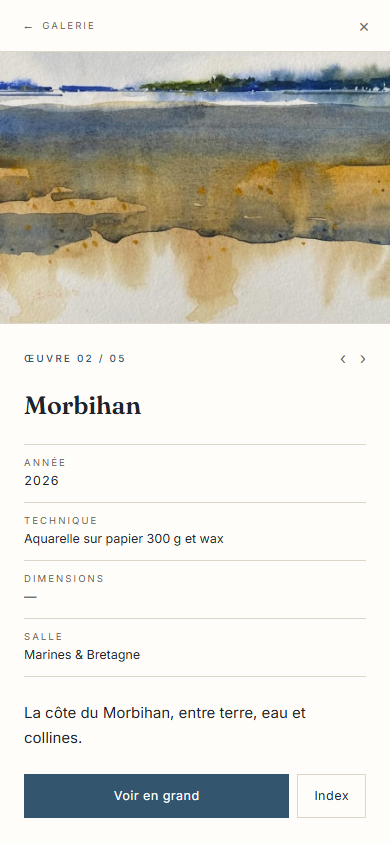

Sur mobile la fiche est une feuille pleine largeur, la grille de méta passe en une colonne.

---

## 3. Le rendu 3D — trois étalonnages

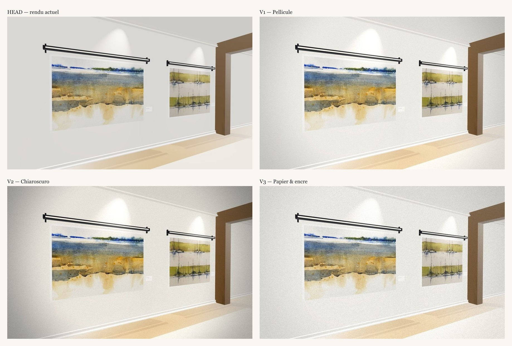

| | Ce que ça change | Où ça se joue |
|---|---|---|
| **V1 — Pellicule** | contraste +10 %, halo doux sur les hautes lumières, grain 5,5 % | bloom 0.30, exposition 1.03, vignette 0.16 |
| **V2 — Chiaroscuro** | salle du soir : exposition −5 %, contraste +20 %, halo franc, vignette marquée | bloom 0.52, vignette 0.34 |
| **V3 — Papier & encre** | plus clair, plus mat, grain de papier visible à 11 % | bloom 0.16, saturation −4 % |

> ⚠️ Ces planches simulent **l'étalonnage, le bloom et le grain** à partir d'une capture du rendu
> actuel. Elles ne peuvent pas simuler l'occlusion ambiante ni l'anti-aliasing temporel : ces deux
> effets ne se voient qu'en mouvement, et n'existent pas encore dans le projet (aucun
> post-processing aujourd'hui). Voir `../audit-3d.md` pour le plan et les chiffres.

**Le constat important :** l'étalonnage ne suffira pas. Ce qui écrase les tableaux aujourd'hui,
c'est le **luminaire noir** (voir ci-dessous) et le `emissiveIntensity 0.1` qui délave la texture.
Tant que ces deux points ne sont pas traités, aucun grade ne rendra la scène juste.

---

## 4. Cadres & luminaires — quatre montages

[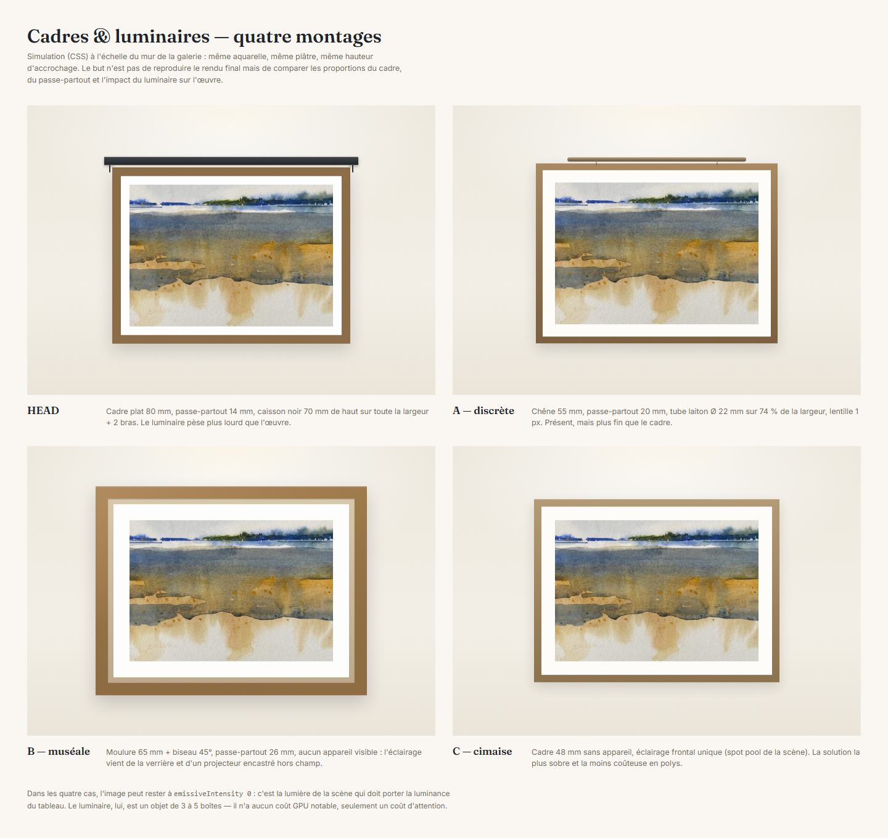](shots/D-cadres-luminaires.png)

| | |
|---|---|
| **HEAD** | caisson noir de 70 mm de haut sur **toute la largeur + 2 bras**, plus large que la toile. C'est l'élément le plus contrasté de l'écran — devant les tableaux. Le cadre est par ailleurs enterré dans le mur (face avant à 5,880 pour un parement à 5,875) et le passe-partout est coplanaire avec le mur : z-fighting. |
| **A — discrète** | chêne 55 mm, passe-partout 20 mm, tube laiton Ø 22 mm sur **74 %** de la largeur, lentille de 1 px. Présent, plus fin que le cadre. |
| **B — muséale** | moulure 65 mm + biseau 45°, passe-partout 26 mm, **aucun appareil visible** : la lumière vient de la verrière et d'un projecteur encastré hors champ. |
| **C — cimaise** | cadre 48 mm, aucun appareil, éclairage frontal unique. Le plus sobre, le moins coûteux en polys. |

Ma recommandation : **B** pour les grandes toiles, **A** pour les formats moyens, et **C** partout
où la salle est déjà baignée de lumière. Aucun des trois ne coûte plus de 5 boîtes par œuvre.

---

## 5. Ce qu'il reste à décider (réponds par numéros)

1. **Direction de chrome** — A, B, C, ou l'hybride **B en desktop + A en mobile** (ma reco) ?
2. **Fiche d'œuvre** — la spec ci-dessus est-elle validée ? Variante possible : image avec une marge
   de 24 px (plus « catalogue ») plutôt que bord à bord (plus « musée »).
3. **Étalonnage 3D** — V1, V2 ou V3 ? (ma reco : V1, avec un halo un peu plus franc sur les toiles)
4. **Cadres & luminaires** — HEAD corrigé, A, B ou C ? (ma reco : B pour les grandes, A sinon)
5. **Index** — images rognées (`cover`, compact) ou **non rognées** (`contain`, on voit la toile
   entière, ma reco) ?
6. **Intro** — on garde la bande de 3 aperçus, ou wordmark seul comme la direction C ?
7. **Mode libre** — bouton permanent (aujourd'hui), ou touche `F` + une entrée dans l'index ?
8. **Rythme de scroll** — on garde le scroll natif actuel (léger, robuste), ou on chorégraphie les
   transitions avec GSAP ScrollTrigger (plus cinématographique, +45 ko, à cadrer avec le post-
   processing) ? *C'est l'étape optionnelle de l'ordre d'exécution : je ne l'engage pas sans ton feu vert.*

### Régénérer les images

Les maquettes sont des fichiers HTML autonomes (polices Google, aucune dépendance). Les scripts
sont dans `tools/` : `plate.mjs` (capture la scène sans HUD → `refs/plate-*.jpg`), `shoot-mock.mjs`
(capture les maquettes → `shots/`), `grade2.mjs` (étalonnages → `3d/`), `measure-chrome.mjs`
(mesures DOM du chrome), `beforeafter.mjs` hors dépôt. Les `plan-*.json` donnent les viewports.

---

Une fois ces 8 réponses données, j'implémente dans cet ordre : `DESIGN.md` (tokens) → chrome →
fiche/index → rendu 3D → rythme. Chaque étape reste sur cette branche, avec captures avant/après.
