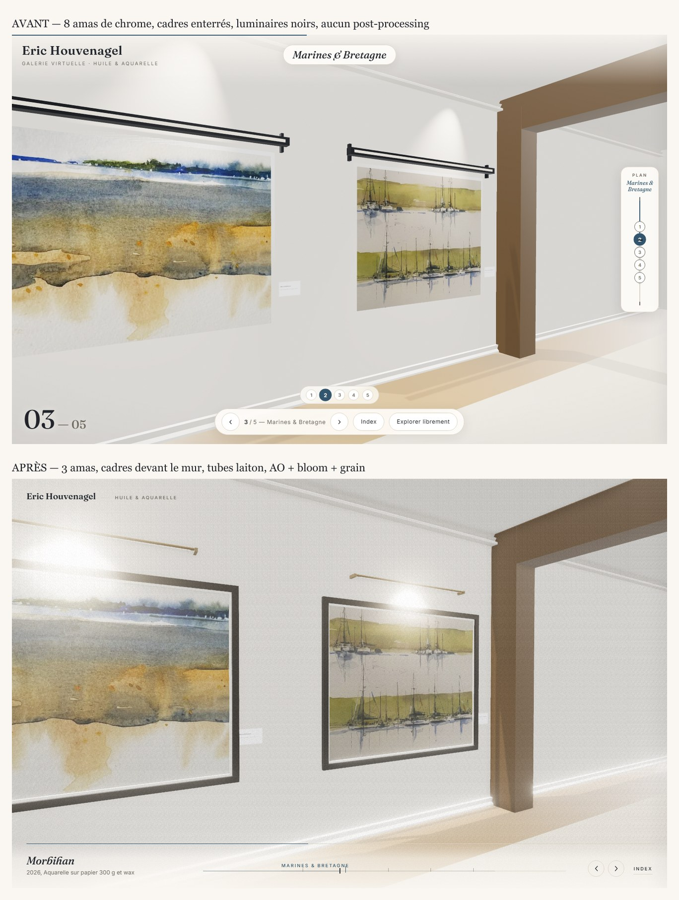
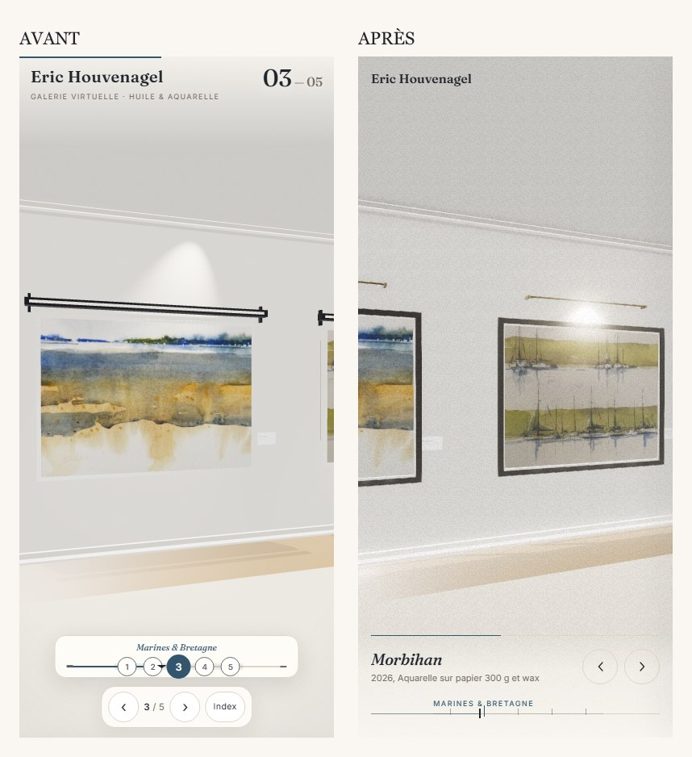
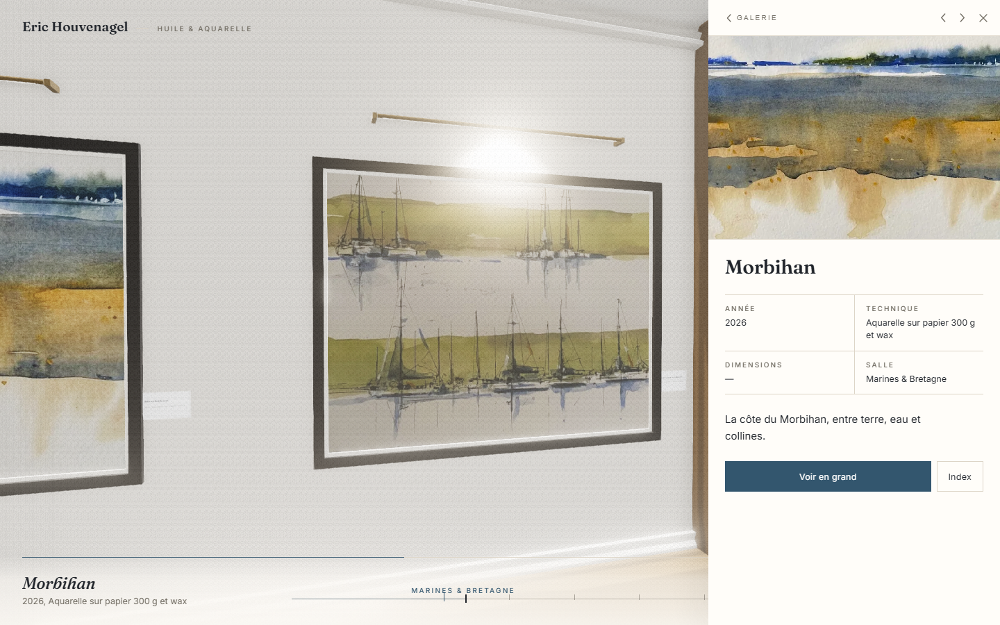
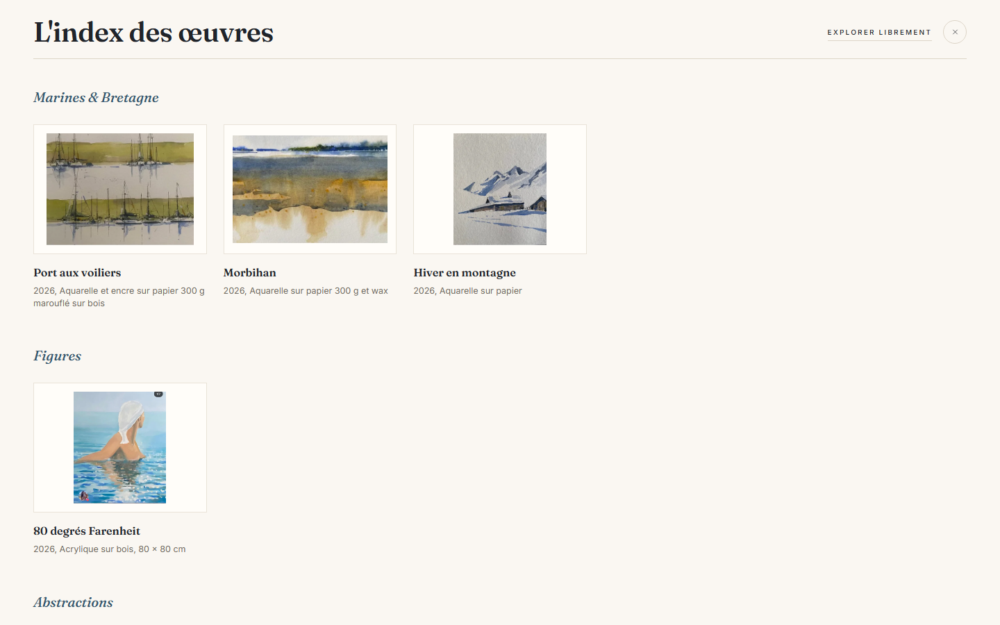

# Refonte appliquée — `feat/rebuild-v3`

Ce qui est **fait** sur cette branche, ce qui reste à arbitrer, et pourquoi le rythme de scroll
n'est pas encore engagé. Le diagnostic et les propositions sont dans
[`audit-ui.md`](audit-ui.md), [`audit-3d.md`](audit-3d.md) et [`proposals/`](proposals/).
Le système cible est dans [`../../DESIGN.md`](../../DESIGN.md).

## Avant / après





Trois commits :

| Commit | Contenu |
|---|---|
| `refonte(ui)` | chrome de 8 amas à 3, cartel en bas, fiche recomposée, index, échelle typo à 5 marches |
| `refonte(3d)` | lumière qui entre par la trémie, cadres devant le mur, tubes laiton, `TableSpots`, AO + bloom + SMAA + grain |
| ce document | synthèse, arbitrages restants, rythme |

## 1. UI — ce qui a été appliqué

| Point de l'audit | État |
|---|---|
| 8 amas → 3 (identité, cartel, commandes) | fait |
| plan flottant, pastilles, compteur 58 px, bannière, curseur, hints en boucle | supprimés |
| le plan devient un rail de 1 px (graduations cliquables, salle courante, curseur caméra) | fait |
| fiche : image bord à bord rayon 0, méta en grille 2 × 2, actions sur une rangée | fait |
| index : une grille, œuvres non rognées, méta sur 2 lignes | fait |
| 22 tailles de police → 5, 9 rayons → 1, 11 ombres → 2, 20 transitions → 4 | fait |
| icônes SVG dessinées, surfaces du navigateur (sélection, focus, scrollbar) accordées | fait |
| copie : plus de sur-titre au-dessus d'un titre, plus de « · » ni de tiret cadratin dans les métas | fait |





## 2. 3D — ce qui a été appliqué

Détail du câblage et des leviers dans [`3d-integration.md`](3d-integration.md).
Les quatre P0 de l'audit sont traités : cadre hors du mur et passe-partout non coplanaire,
luminaires fins qui éclairent vraiment, `emissiveIntensity` de la toile à ~0, chaîne de
post-processing AO → bloom → ACES → SMAA → grain.

## 3. Ce qu'il reste à trancher

| # | Point | Constat sur les captures | Levier |
|---|---|---|---|
| 1 | **Couleur du cadre** | le cadre « discret » lit charbon, pas chêne : plus galerie contemporaine que le `#A08055` du guide de style | `FRAME_METRICS` dans `frames.ts` (teinte du bois), ou `FRAME_VARIANT = 'museum'` |
| 2 | **Motif du plâtre** | la trame de la texture (tuile de 8,5 m) se devine sur les grands aplats de mur | échelle de tuile dans `scene.ts` (`PLASTER_TILE`) + atténuation du `bumpScale` |
| 3 | **Halo de la tache solaire** | la tache de soleil sur le mur, en haut à gauche, bave un peu avec le bloom | `POST_TUNING.bloom.strength` 0,30 → 0,22 |
| 4 | **Grain** | ±0,028 à 24 Hz se voit à 100 % ; c'est voulu, mais réglable | `POST_TUNING.grain.amount` |
| 5 | **Cadrage au repos** | à `t = 0,45` la première toile est coupée par le bord gauche | `pathX` / `viewDist` dans `layout.ts` |

Aucun de ces cinq points n'est bloquant : ce sont des curseurs, chacun sur une constante.

## 4. Rythme de scroll — non engagé, volontairement

L'étape « GSAP ScrollTrigger » n'est **pas** implémentée. Décision et raisons :

1. **Il n'y a qu'un seul driver de scroll, et il fonctionne.** `controls.ts` lit `window.scrollY`,
   en dérive `targetT` et lisse la position. ScrollTrigger n'apporterait pas un driver meilleur ;
   il apporterait des timelines scrubées, du pinning et du snap — dont on n'a besoin pour aucun
   des effets visés ici.
2. **Le coût est réel** : ~45 ko de plus sur un site qui sert déjà 2,8 Mo d'images et un bundle
   three.js, pour un gain de rythme que l'on peut obtenir autrement.
3. **Le risque est sur le chemin critique** : la navigation (flèches, clavier, rail, fin de
   visite) passe toute par ce mapping scroll → caméra. Le réécrire juste avant livraison, sur une
   branche qui n'a pas encore été vue sur appareil réel, c'est prendre le risque de casser la
   seule chose que le visiteur utilise vraiment.

### Ce que « chorégraphier » voudrait dire concrètement

L'effet recherché (le rythme d'une salle de musée) est un **temps d'arrêt devant chaque œuvre**,
pas une animation de plus. La façon la moins risquée de l'obtenir est une courbe, pas une
bibliothèque :

```
t scroll (0 → 1)  ──►  camZ
linéaire aujourd'hui : camZ = lerp(zFirst, zLast, t)
proposé               : camZ = lerp(zFirst, zLast, dwell(t))
                        où dwell() est monotone, dérivée ~0 sur ±8 % autour de chaque œuvre
```

- une fonction pure dans `layout.ts` (testable, sans DOM), ~25 lignes ;
- `progressT()` et la détection de fin restent inchangés : seule la position intermédiaire bouge ;
- effet : la caméra ralentit devant chaque tableau et accélère entre deux, sans que le visiteur
  ait à s'arrêter de scroller ;
- repli : `prefers-reduced-motion` → courbe linéaire.

Deuxième effet, gratuit et déjà possible : le fondu de la légende quand on change d'œuvre
(240 ms, `--d-ui`), aujourd'hui instantané.

Si tu veux la version GSAP malgré tout, l'architecture propre est : `ScrollTrigger` sur le
`#scroll-spacer` avec `scrub: 0.6`, une seule timeline de caméra, `web3d-integration-patterns`
pour garder `post.render` hors de la boucle GSAP et un seul `ScrollTrigger.refresh()` après le
chargement des textures. C'est un demi-jour de travail et une régression possible sur mobile.
